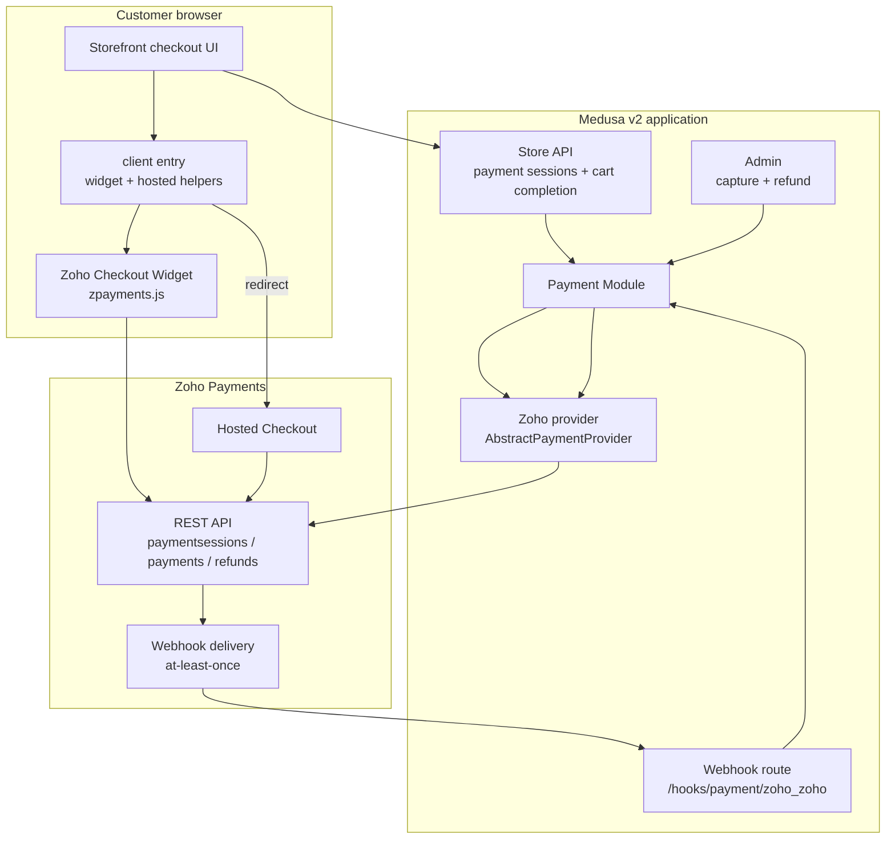
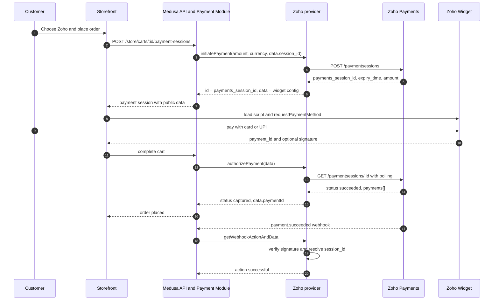
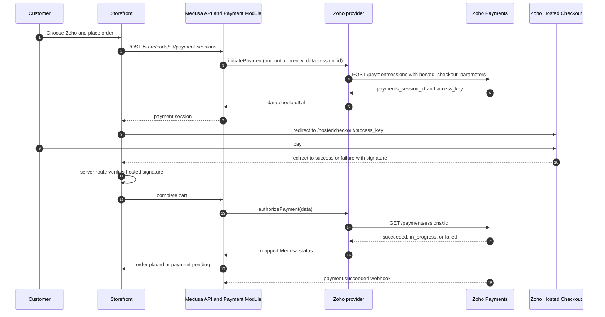
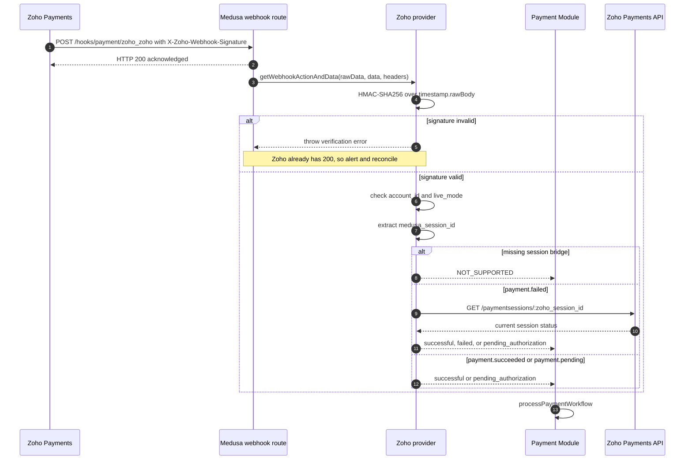
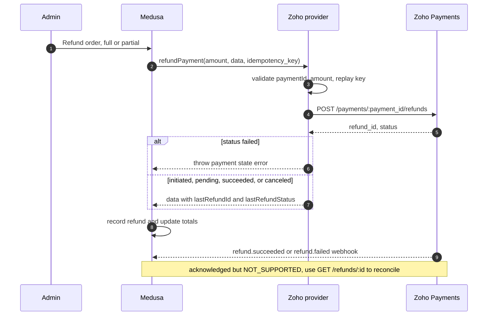
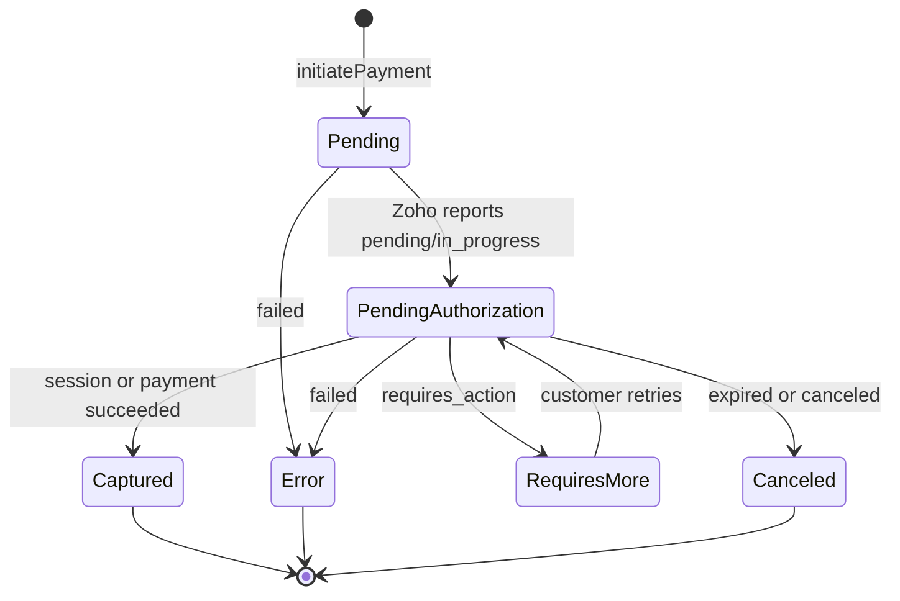

# Architecture

- **Package:** `medusa-payment-zoho`
- **Date:** 2026-10-23
- **Status:** Current design
- **Decisions:** [ADR-0001](./decisions/ADR-0001-package-identity.md) through
  [ADR-0007](./decisions/ADR-0007-signature-verification.md)

## 1. Overview

`medusa-payment-zoho` is a Medusa v2 payment module provider plus two small helper
entry points. It translates Medusa's payment-session lifecycle into Zoho Payments'
session/payment/refund model, and translates signed Zoho webhooks back into Medusa
payment actions.

The design has four boundaries:

1. **Medusa server** — owns payment sessions, payments, refunds, and order completion.
2. **Provider** — owns Zoho API calls and status mapping; never owns commerce state.
3. **Customer browser** — runs the Zoho widget or redirects to hosted checkout; never
   holds server secrets and never decides that a payment succeeded.
4. **Zoho Payments** — owns the actual money movement and the authoritative status.

## 2. Component map



The `client` entry point is browser-only and imports neither `node:*` nor
`@medusajs/*`. The `server` and root entry points are server-side; both expose the
`node:crypto` signature helpers, so neither belongs in a storefront bundle.

## 3. Data model and the session bridge

Medusa's `PaymentSession` stores the provider's returned `data`. The provider-owned
portion is:

```text
zohoSessionId, checkoutMode, amount, currencyCode, currencySymbol,
description, invoiceNumber, expiresAt, widget?, checkoutUrl?,
medusaSessionId?, paymentId?, paymentStatus?, previousZohoSessionIds?,
lastRefundId?, lastRefundStatus?, lastRefundIdempotencyKey?
```

The **Medusa payment-session ID** is the bridge:

- Medusa injects it as `data.session_id`;
- the provider writes it to Zoho `reference_number` and
  `meta_data.medusa_session_id`;
- a signed webhook reads it back from `payment.meta_data` or
  `payment.reference_number`; and
- Medusa receives it as the webhook action's `session_id`.

If the bridge is missing, the provider does not guess. It returns
`NOT_SUPPORTED` for the webhook and relies on polling.

`data` is public to the storefront. Secrets are excluded by type, by review, and by
tests. The hosted `checkoutUrl` contains Zoho's `access_key`; treat it as a bearer
capability and do not log it.

## 4. Embedded widget flow

The default `checkoutMode` is `"widget"`. The server creates the Zoho session; the
browser opens the widget with publishable data; Medusa verifies the result server-side.



Notes:

- The widget's `payment_id` is a hint. The provider retrieves the session/payment
  before Medusa creates an order.
- `authorizePayment` polls only until a terminal session status or the configured
  attempt limit. The webhook is the asynchronous backstop.
- The widget signature is optional in Zoho's response; its absence does not block
  server-side verification.

## 5. Hosted checkout flow

`checkoutMode: "hosted"` uses the same session resource but returns a redirect URL.



Notes:

- The provider cannot verify the browser return URL itself; the merchant's server route
  uses `isValidZohoHostedCheckoutSignature`.
- ACH `in_progress` is not final success. The order may be created awaiting payment and
  completed by the webhook.
- If the customer closes the browser, the session is still resolvable by ID and by
  webhook.

## 6. Webhook completion

Zoho delivers at-least-once. Medusa's route acknowledges before the provider handler
finishes, so the provider must fail closed and monitoring must catch rejected events.



Duplicate delivery is expected. The handler is read-only apart from the reconciliation
lookup, so duplicates map to the same action; Medusa's workflow owns the state
transition. There is no durable `event_id` store in v1.

## 7. Refund flow

Refunds are created against a captured payment. Zoho's refund status is asynchronous;
its webhook is not mapped to a Medusa action.



Retry rules:

- `POST /payments/{id}/refunds` uses `retryPolicy: "none"`: only an explicit `429` is
  retried.
- A timeout or `5xx` is surfaced; it may already have succeeded at Zoho.
- The local replay guard returns early only when the same Medusa idempotency key has
  already produced a stored refund ID.

## 8. Logical state machine



`Captured` is terminal for the provider's session state. Refunds do not change the
payment session to a refunded state; Medusa records refunds separately and the provider
still reports the original payment as captured (`refunded`/`partially_refunded` map to
`CAPTURED`).

## 9. Trust boundaries and security invariants

| Boundary                 | Rule                                                                   |
| ------------------------ | ---------------------------------------------------------------------- |
| Storefront ↔ Medusa      | Storefront never decides success; it may only display a hint           |
| Medusa ↔ Zoho API        | OAuth token server-side; `account_id` on every call; TLS only          |
| Zoho ↔ webhook route     | HMAC over exact raw body before any field is read                      |
| Webhook route ↔ provider | Bad signature throws; account and live/test mode are checked           |
| Server ↔ browser         | `client` entry has no Node built-ins, no Medusa imports, no secrets    |
| Payment `data`           | Public; only publishable widget config and non-sensitive identifiers   |
| Logs                     | No client secret, refresh token, access token, signing key, or body    |
| Hosted `checkoutUrl`     | Capability URL containing `access_key`; do not log or persist publicly |

Additional invariants:

- Money is formatted with `BigNumber` and ISO fraction digits; no binary floating point.
- No silent failures: errors are typed and mapped to Medusa error types.
- A missing signing key fails closed; there is no unverified mode.
- Webhook rejection is monitored because the route has already returned 200.

## 10. Failure and retry behaviour

| Failure                       | Behaviour                                                     |
| ----------------------------- | ------------------------------------------------------------- |
| OAuth 401                     | Invalidate cache, refresh, retry request once                 |
| OAuth 429/5xx/network         | Exponential backoff, up to `maxRetries`                       |
| OAuth invalid_grant           | Fail immediately; credentials need attention                  |
| Safe GET/POST network or 5xx  | Retry with backoff                                            |
| Refund POST timeout or 5xx    | Surface; do not retry                                         |
| Refund POST 429               | Retry                                                         |
| Zoho session expired          | New session on next initiate/update; old one is abandoned     |
| `payment.failed` per attempt  | Reconcile session; fail only if session is terminal           |
| Duplicate webhook             | Same read-only action; Medusa applies the transition          |
| Missing Medusa session bridge | `NOT_SUPPORTED`; reconcile by polling                         |
| Widget script blocked by CSP  | Helper returns a load error; merchant can fall back to hosted |

## 11. Observability

The provider logs structured context through Medusa's logger (or an injected logger):

- action (`initiate payment`, `authorize payment`, `process webhook`, …);
- Zoho error code and request ID;
- event type for webhooks;
- retry attempt and delay;
- configuration warnings such as a missing signing key.

It never logs request/response bodies, OAuth tokens, the client secret, the refresh
token, the signing key, or computed signatures. Recommended alerts:

- any `ZOHO_WEBHOOK_VERIFICATION_ERROR`;
- an unexpected rate of `NOT_SUPPORTED` for `payment.*` events;
- a spike in `ZOHO_AUTHENTICATION_ERROR` (credential rotation or revocation);
- refunds stuck in `initiated`/`pending` beyond the expected settlement window.

## 12. Deployment notes

- Configure the provider with `id: "zoho"` so the webhook route is
  `/hooks/payment/zoho_zoho`.
- Configure Zoho webhooks manually for `payment.succeeded`, `payment.pending`, and
  `payment.failed` at minimum; add refund events only if a separate reconciliation job
  consumes them.
- Set the signing key from Zoho Developer Space. Without it, checkout still works but
  signatures and webhooks cannot be verified; the provider warns at startup.
- Allow outbound HTTPS to the regional `payments.zoho.*` and `accounts.zoho.*` hosts.
- For the widget, allow `https://static.zohocdn.com` and the regional payments domain
  in CSP; for hosted checkout, allow the redirect.
- Ensure the app's public URL is reachable by Zoho for webhook registration.
- Use HTTPS for `successUrl`/`failureUrl` in production; the option validator enforces
  it outside localhost.

## 13. Testing map

| Layer            | What is covered                                                   |
| ---------------- | ----------------------------------------------------------------- |
| Amount utilities | ISO fraction digits, zero/three-decimal currencies, invalid codes |
| Status mapping   | Every Zoho status row, unknown values, terminal detection         |
| Signatures       | Webhook/widget/hosted vectors, tampering, tolerance, missing key  |
| OAuth            | Cache, single-flight, 401 once, retryable vs terminal failures    |
| HTTP             | Safe vs none retry policy, `Retry-After`, timeout, no secret logs |
| Session data     | Parsing untrusted data, metadata limits, expiry normalization     |
| Provider         | Both checkout modes, reuse, polling, capture/cancel/refund edges  |
| Webhook          | Event mapping, failed-attempt reconciliation, account/mode checks |
| Browser helper   | Script load, jsdom widget flow, close, timeout, error reasons     |
| Packaging        | Exports, types, browser bundle purity, publint/attw               |

## 14. References

- [Zoho Payments research](./research/zoho-payments.md)
- [Medusa provider research](./research/medusa-v2-payment-provider.md)
- [Community module review](./research/community-modules.md)
- [Compatibility and limitations](./compatibility.md)
- [Reference index](./research/references.md)
